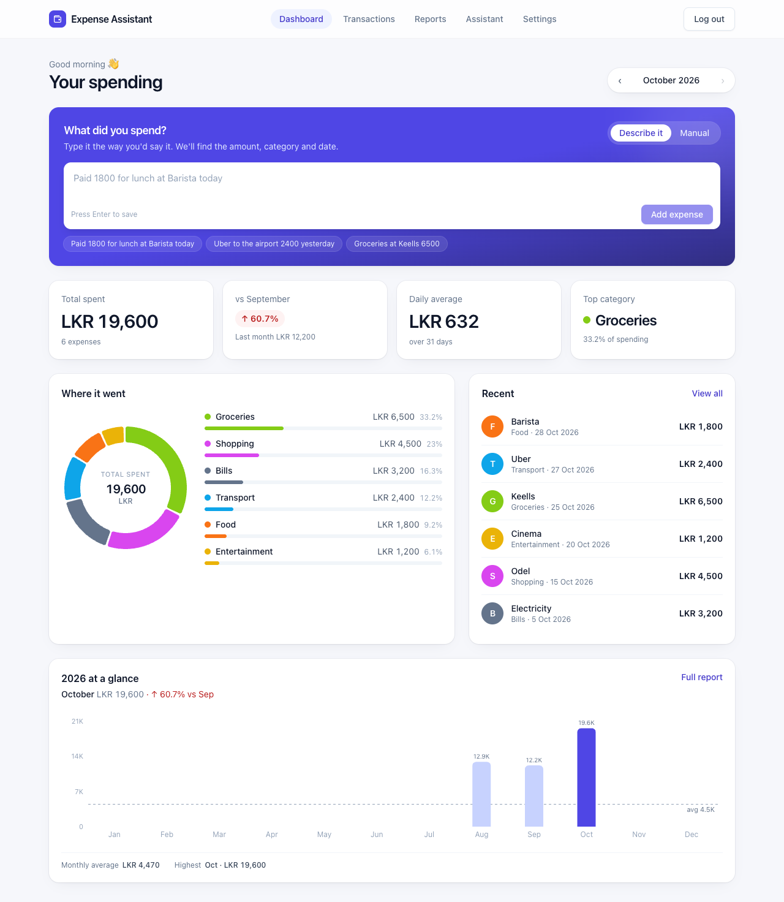
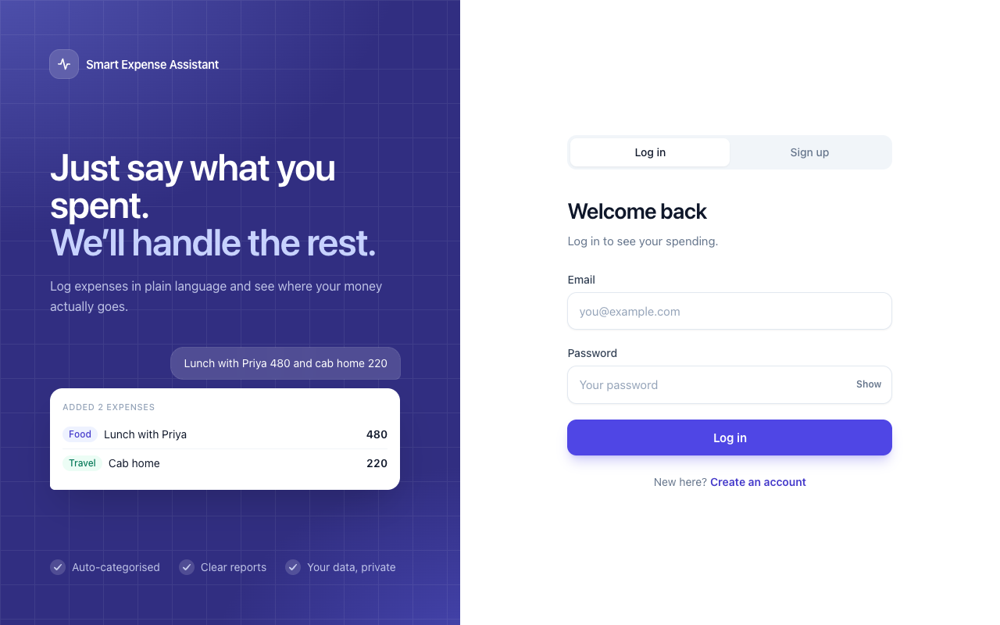
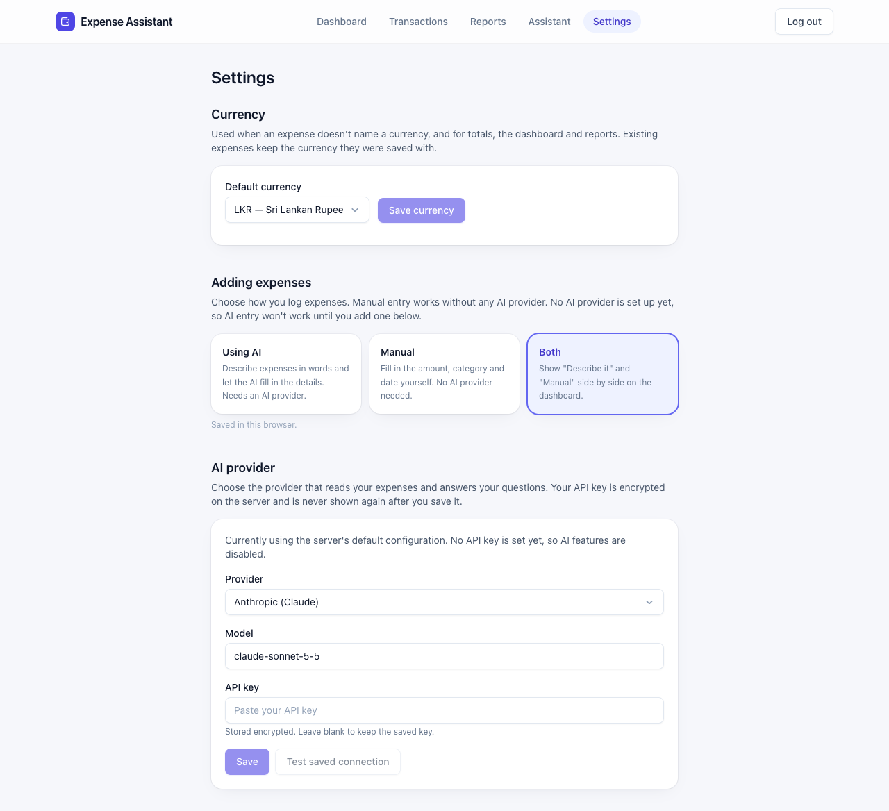
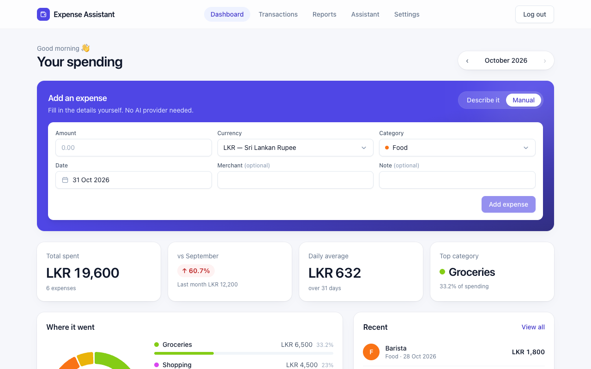
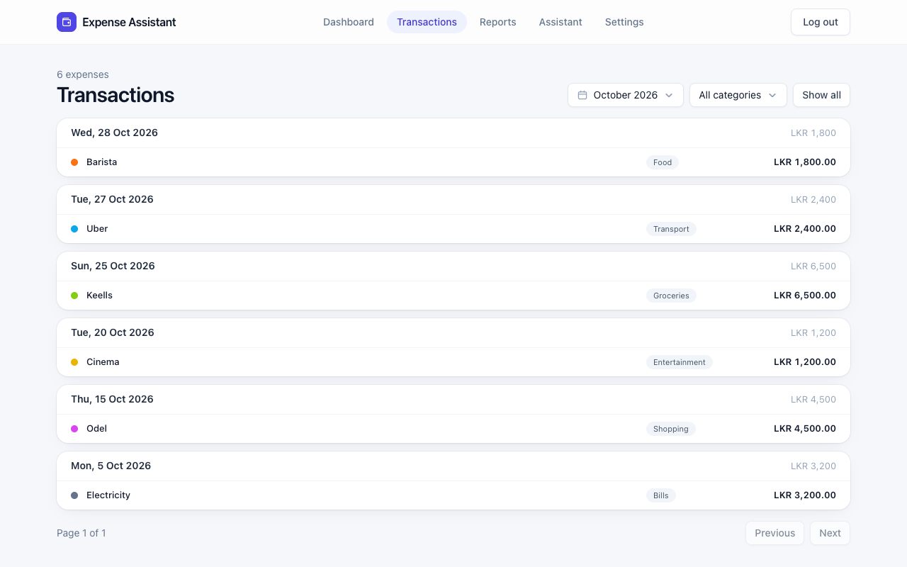
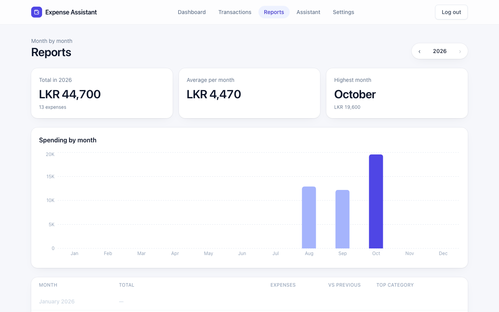
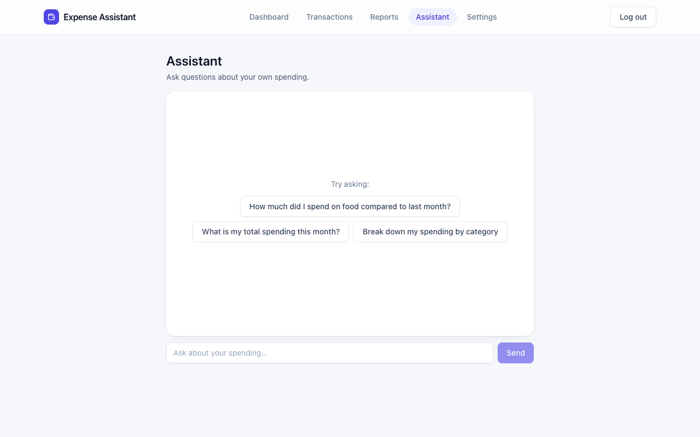

# Smart Expense Assistant

A simple app to keep track of the money you spend.

Instead of filling in boxes, you can just **type what you spent, the way you'd say it**:

> "Paid 1800 rupees for lunch at Barista today"

The app works out the amount, category (Food, Travel, ...), shop name and date for you, and saves it.
You can also fill in a form by hand if you prefer. Later you can look at charts of where your money
went, and **ask questions in plain English**, like "How much did I spend on food compared to last month?"



---

## What you can do with it

| Page | What it's for |
|---|---|
| **Dashboard** | Add an expense and see this month's spending at a glance. |
| **Transactions** | See every expense in a list. Search, filter by month or category, fix or delete entries. |
| **Reports** | Charts showing spending by month and by category. |
| **Assistant** | A chat where you ask questions about your own spending. |
| **Settings** | Choose your currency, how you add expenses, and which AI to use. |

Your data stays on your own computer. Each person has their own account and only sees their own expenses.

---

## Before you start

You need to install **one** free program: **Docker Desktop**. It runs the whole app for you, so you
don't have to install anything else.

1. Go to <https://www.docker.com/products/docker-desktop/> and download it for your computer (Mac or Windows).
2. Install it and **open it**. Wait until it says Docker is running.

Optional: to use the "type it in words" feature and the Assistant, you need an **AI key** (a password
that lets the app talk to an AI service such as Anthropic's Claude or OpenAI). Without it, everything
still works except those two things, and you can add expenses with the form.

---

## Set it up on your computer

You only do this once.

1. **Get the project folder** on your computer and open a terminal inside it.
   - Mac: open the *Terminal* app, type `cd ` (with a space), drag the project folder into the window, press Enter.
   - Windows: open the folder, click the address bar, type `cmd`, press Enter.

2. **Create your settings file** by running:

   ```bash
   cp .env.example .env
   ```

   (On Windows Command Prompt use `copy .env.example .env`.)

3. **Open the new `.env` file** in any text editor (Notepad, TextEdit) and change these:
   - `JWT_SECRET=` : replace the text after `=` with any long random sentence (at least 32 characters). This keeps your login secure.
   - *(Optional)* `ANTHROPIC_API_KEY=` : paste your AI key after `=`. You can also skip this and add the key later inside the app (see "Choosing the AI" below).

   Save the file.

4. **Start the app:**

   ```bash
   docker compose up --build
   ```

   The first time takes a few minutes while things download. When the messages stop scrolling, it's ready.

5. **Open your browser** and go to **<http://localhost:3000>**.

### Starting and stopping later

- **Stop:** press `Ctrl + C` in the terminal, or run `docker compose down`.
- **Start again:** run `docker compose up` (no need for `--build` unless something was changed).
- Your expenses are kept between runs.

---

## How to use it

### 1. Create your account
On the first screen choose to create an account with your email and a password. Next time, just log in.



### 2. Pick your currency
Open **Settings** and choose the currency you normally use (for example LKR, INR, USD). Totals and charts use it.



### 3. Add an expense
On the **Dashboard**, depending on your setting you'll see one or both of these:

- **Describe it (AI):** type a sentence such as
  - "Paid 1800 for lunch at Barista today"
  - "Uber to the airport 2400 yesterday"
  - "Groceries at Keells 6500"

  Check what the app understood, fix anything that's wrong, and save.
  If your sentence is missing something (like the amount), the app will tell you what to add.
- **Manual:** fill in the amount, category, shop, and date yourself, then save.



### 4. Look back at your spending
- **Transactions:** browse, search, change a category, or delete a mistake.
- **Reports:** see which months and categories cost the most.





### 5. Ask the Assistant
Open **Assistant** and ask in your own words, for example:

- "How much did I spend this month?"
- "How much did I spend on food compared to last month?"
- "Where is most of my money going?"

The numbers come from your saved expenses, not guesses.



---

## Settings explained

### Adding expenses
Choose how you want to add expenses:

1. **Using AI**: type a sentence and the AI fills in the details. Needs an AI key.
2. **Manual**: fill in a form yourself. No AI needed.
3. **Both**: have both options on the dashboard and switch between them.

This choice is remembered in your browser. The settings page above shows the three options under "Adding expenses".

### Choosing the AI
In **Settings → AI provider**, pick Anthropic (Claude), OpenAI, or Ollama (an AI that runs free on your
own computer), then paste your key. The key is stored scrambled (encrypted) and is never shown again.

---

## If something goes wrong

| Problem | Try this |
|---|---|
| The page won't open | Make sure Docker Desktop is running and the terminal still shows the app running. Then reload <http://localhost:3000>. |
| "Port already in use" | Another program is using the same door. Close it, or run `docker compose down` and start again. |
| "AI not configured" | Add an AI key in **Settings**, or switch "Adding expenses" to **Manual**. |
| "Too many requests" | You hit the safety limit. Wait a minute and try again. |
| Forgot to change `JWT_SECRET` | Stop the app, edit `.env`, and start it again. You'll need to log in again. |

---

## For developers

The technical details (how it's built, running without Docker, every setting, API examples, tests) are in
[docs/TECHNICAL.md](docs/TECHNICAL.md). In short: a Python (FastAPI) backend, a Next.js frontend and a
PostgreSQL database. The API documentation is at <http://localhost:8000/docs> while the app is running.
